# HipMRI Prostate Segmentation With 2D and 3D U-Nets

**COMP3710 Pattern Recognition**

**Student ID:** 49069154

**Repository branch:** `topic-recognition`

## Main Finding

The two 3D models produced substantially better prostate contours than the slice-wise 2D baseline. Patient-balanced prostate Dice increased from **0.7426** for Basic 2D U-Net to **0.8113** for Standard 3D U-Net. The Improved 3D U-Net reached 0.8102 and did not reliably outperform the standard model. Standard 3D U-Net therefore provides the best current balance of prostate accuracy, model complexity, and inference cost.

## Abstract

This project evaluates an annotation-assistance prototype for pelvic MRI segmentation. The study uses 211 aligned HipMRI volumes from 38 patients and compares a Basic 2D U-Net, a Standard 3D U-Net, and an Improved 3D U-Net on one fixed patient-level split. All models use the same resized inputs, loss, seed, and held-out test cases. The 3D models improved the most clinically relevant target, the prostate, especially near its base and apex. The 2D model remained competitive on larger structures but lost inter-slice continuity. Extra residual blocks and deep supervision did not produce a stable prostate gain over the standard model. Results are preliminary because the test set contains six patients.

## Feasibility Review

### User Need Scope and Acceptance Criteria

The intended user is a radiotherapy planning team. The prototype proposes draft contours for the body, bladder, bone, rectum, and prostate for review by an imaging specialist. It is not an autonomous clinical decision system.

- Use a deterministic patient-level split with no patient appearing in more than one partition.
- Achieve a held-out prostate Dice of at least 0.70 and report per-class Dice and IoU.
- Compare 2D and 3D models using pooled, scan, and patient-balanced metrics.
- Inspect at least three boundary cases and identify false-positive and false-negative regions.
- Fit within 12 GB VRAM and report parameter count, memory, and latency.

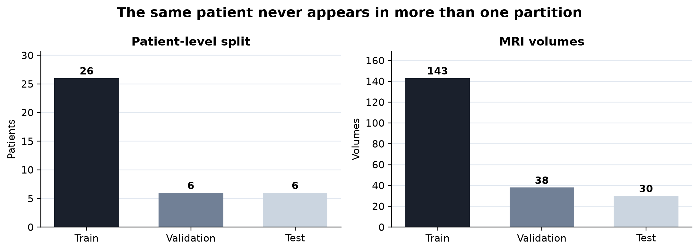

### Model Choice and Course Concepts

The hard-difficulty proposed model is a four-level 3D Improved U-Net with residual learning, learned downsampling, dropout, and two deep-supervision heads. Standard 3D U-Net isolates the benefit of these additions, while Basic 2D U-Net tests whether volumetric context is useful.

### Preliminary Feasibility Evidence

| Evidence | Basic 2D | Standard 3D | Improved 3D |
|---|---:|---:|---:|
| Patient prostate Dice | 0.7426 | 0.8113 | 0.8102 |
| Base Dice | 0.4649 | 0.6096 | 0.6122 |
| Peak VRAM MB | 895.4 | 712.2 | 999.4 |
| Inference per volume ms | 11.60 | 10.03 | 10.64 |

All three models exceed the 0.70 prostate Dice target. Both 3D models improve patient-balanced prostate Dice and reduce the base deficit. Standard 3D currently gives the best accuracy-cost balance.

### Risks Budget and Fallback

The main risks are the small patient cohort, repeated weekly scans, prostate class imbalance, and loss of physical spacing during fixed-shape resizing. All models fit within the 12 GB GPU budget, and Standard 3D U-Net remains the efficiency fallback.

## Problem and Data Pipeline

The engineering question is whether 3D spatial context produces safer prostate boundaries than independent 2D slices, and whether residual learning plus deep supervision adds enough benefit to justify a larger model.

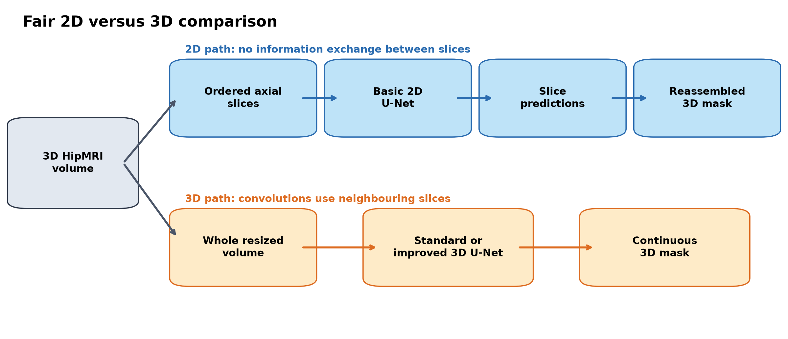

The course HipMRI dataset contains 211 paired NIfTI volumes from 38 patients. The split contains 26 patients and 143 volumes for training, 6 patients and 38 volumes for validation, and 6 patients and 30 volumes for testing. Images are converted to canonical orientation, checked for image-mask alignment, z-score normalised over non-zero voxels, and resized to 64 x 128 x 128. Images use trilinear interpolation; masks use nearest-neighbour interpolation.

The Basic 2D U-Net uses ordered axial slices from the same NIfTI volumes. Predicted slices are reassembled before volume-level evaluation, preserving identical patients and geometry across all models.

## Model Design

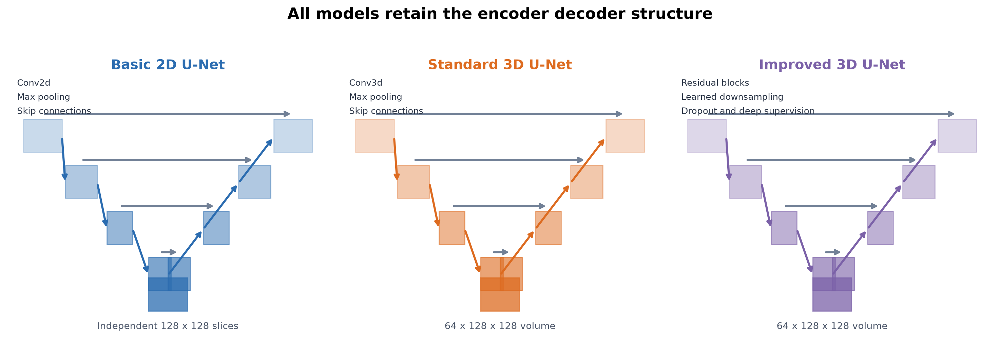

The Basic 2D U-Net uses four encoder and decoder levels with Conv2d, Instance Normalisation, ReLU, and skip connections. Standard 3D U-Net replaces these operations with 3D counterparts. Improved 3D U-Net adds pre-activation residual blocks, learned stride-two downsampling, dropout, and two auxiliary decoder heads.

## Training and Evaluation

| Setting | Value |
|---|---|
| Input | 64 x 128 x 128 volumes or 64 ordered 128 x 128 slices |
| Optimiser | AdamW |
| Initial learning rate | 3e-4 |
| Weight decay | 1e-5 |
| Loss | 0.5 cross-entropy + 0.5 foreground Dice |
| Batch size | 1 volume |
| Checkpoint metric | Validation mean foreground Dice |
| Early stopping | 20 unimproved epochs |
| Seed | 3710 |

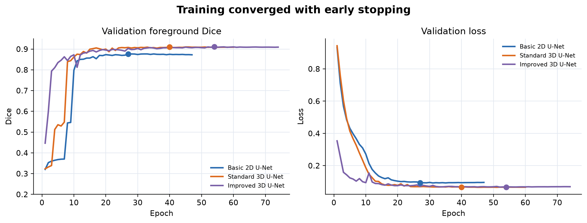

Dice is `2 TP / (2 TP + FP + FN)` and IoU is
`TP / (TP + FP + FN)`. Pooled metrics combine all test voxels, scan means
weight every MRI equally, and patient means first average repeated scans within
each patient. Patient means are the primary comparison because several patients
have multiple weekly scans. Apex and base Dice use three-slice bands at the
inferior and superior ends of the reference prostate. Paired patient bootstrap
intervals use 100,000 resamples and seed 3710.

## Quantitative Results

| Model | Pooled prostate | Scan prostate | Patient prostate | Scan foreground |
|---|---:|---:|---:|---:|
| Basic 2D U-Net | 0.7462 | 0.7373 | 0.7426 | 0.8505 |
| Standard 3D U-Net | 0.7951 | **0.7864** | **0.8113** | 0.8568 |
| Improved 3D U-Net | **0.7988** | 0.7840 | 0.8102 | **0.8572** |

The following tables report pooled test-set metrics calculated by accumulating
TP, FP, and FN over all 30 held-out volumes before computing each score.
Background is included for completeness; the foreground mean averages bladder,
body, bone, rectum, and prostate only.

### Pooled Test Dice by Class

| Model | Background | Bladder | Body | Bone | Rectum | Prostate | Foreground mean |
|---|---:|---:|---:|---:|---:|---:|---:|
| Basic 2D U-Net | 0.9863 | 0.9683 | 0.8956 | 0.8108 | 0.8508 | 0.7462 | 0.8543 |
| Standard 3D U-Net | 0.9900 | 0.9697 | 0.9106 | 0.5375 | 0.8864 | 0.7951 | 0.8199 |
| Improved 3D U-Net | 0.9904 | 0.9740 | 0.9073 | 0.6923 | 0.8705 | 0.7988 | 0.8486 |

### Pooled Test IoU by Class

| Model | Background | Bladder | Body | Bone | Rectum | Prostate | Foreground mean |
|---|---:|---:|---:|---:|---:|---:|---:|
| Basic 2D U-Net | 0.9730 | 0.9385 | 0.8110 | 0.6818 | 0.7403 | 0.5952 | 0.7534 |
| Standard 3D U-Net | 0.9801 | 0.9412 | 0.8359 | 0.3675 | 0.7959 | 0.6599 | 0.7201 |
| Improved 3D U-Net | 0.9810 | 0.9494 | 0.8302 | 0.5294 | 0.7708 | 0.6650 | 0.7489 |

Standard 3D's lower pooled foreground mean is driven by its bone result, even
though it has the strongest patient-balanced prostate Dice. The recommendation
therefore applies to a prostate-focused, specialist-reviewed workflow; an
all-organ system would require further investigation of this bone failure.

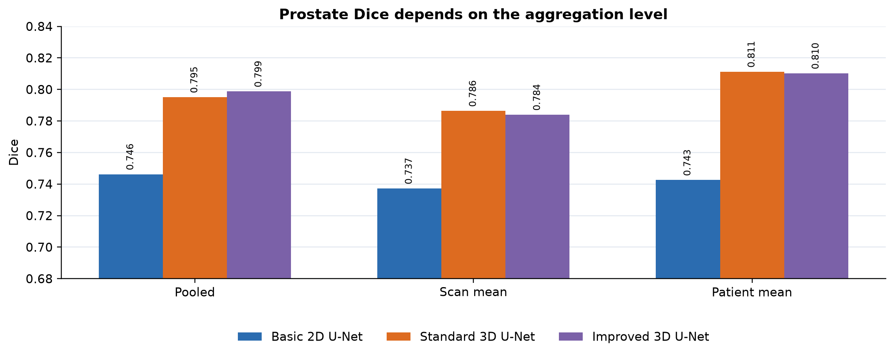

Standard 3D improved patient-balanced prostate Dice over 2D by 0.0687, with a paired patient bootstrap interval of 0.0138 to 0.1300. Improved 3D improved over 2D by 0.0677, with an interval of 0.0184 to 0.1304. Improved 3D minus Standard 3D was -0.0011, with an interval of -0.0225 to 0.0165.

## Boundary and Resource Evidence

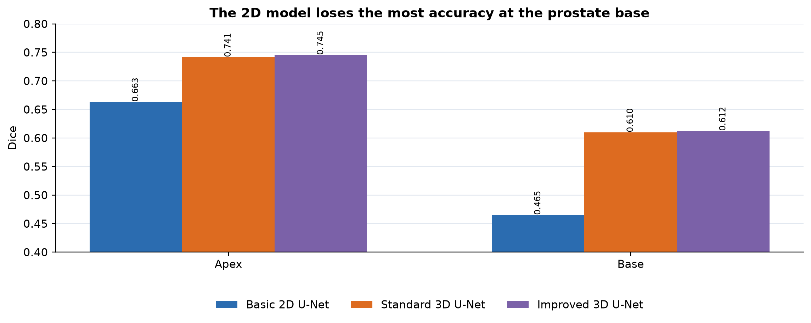

The largest 2D deficit occurs at the prostate base. Base Dice increased from 0.4649 to approximately 0.61 with either 3D model.

| Model | Parameters | Peak VRAM MB | Inference ms | Apex | Base |
|---|---:|---:|---:|---:|---:|
| Basic 2D | 1.94 M | 895.4 | 11.60 | 0.6631 | 0.4649 |
| Standard 3D | 5.65 M | 712.2 | 10.03 | 0.7414 | 0.6096 |
| Improved 3D | 8.04 M | 999.4 | 10.64 | 0.7452 | 0.6122 |

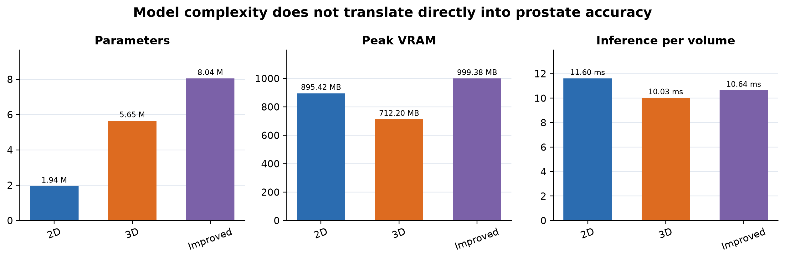

The 2D implementation processes 64 slices as one effective batch, so fewer parameters did not produce lower measured memory or latency. Improved 3D added 42 percent more parameters than Standard 3D without a reliable prostate gain.

## Failure Case Autopsy

### W029 Week5

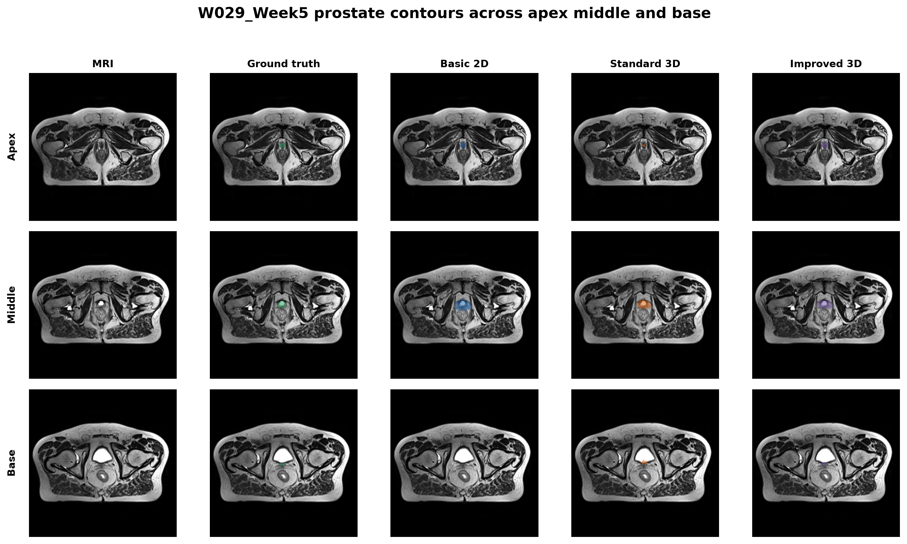

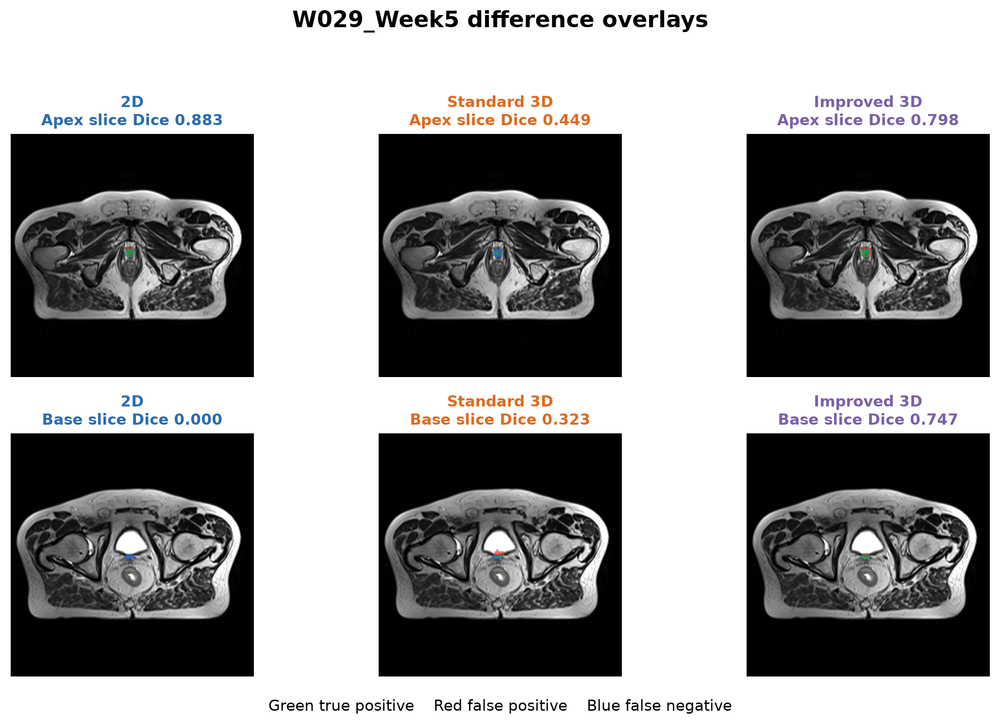

W029 Week5 is difficult for every model. Prostate Dice was 0.532 for 2D,
0.632 for Standard 3D, and 0.598 for Improved 3D. The 2D model missed the
three-slice base band completely. Both 3D models recovered part of the superior
contour, but their case scores remain too low for automatic drafting.

The apex remains partly visible to all models, but the base contains a much
smaller target beside bright bladder anatomy. The 2D model has no evidence from
adjacent slices that the prostate should continue into this level. The improved
model can recover the selected base slice, yet its low band and case scores show
that this recovery is not consistent through the volume.

**Operational decision:** route this case to a specialist. A global Dice
threshold alone does not describe the location or clinical direction of the
error. The system should expose base and apex checks separately and retain the
MRI, prediction, and difference overlay for review.

### B037 Week0

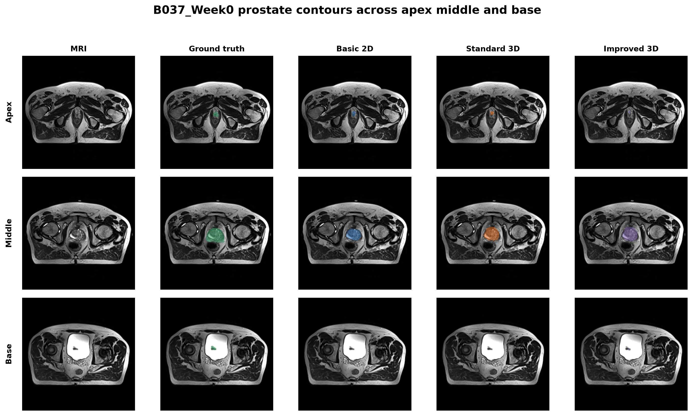

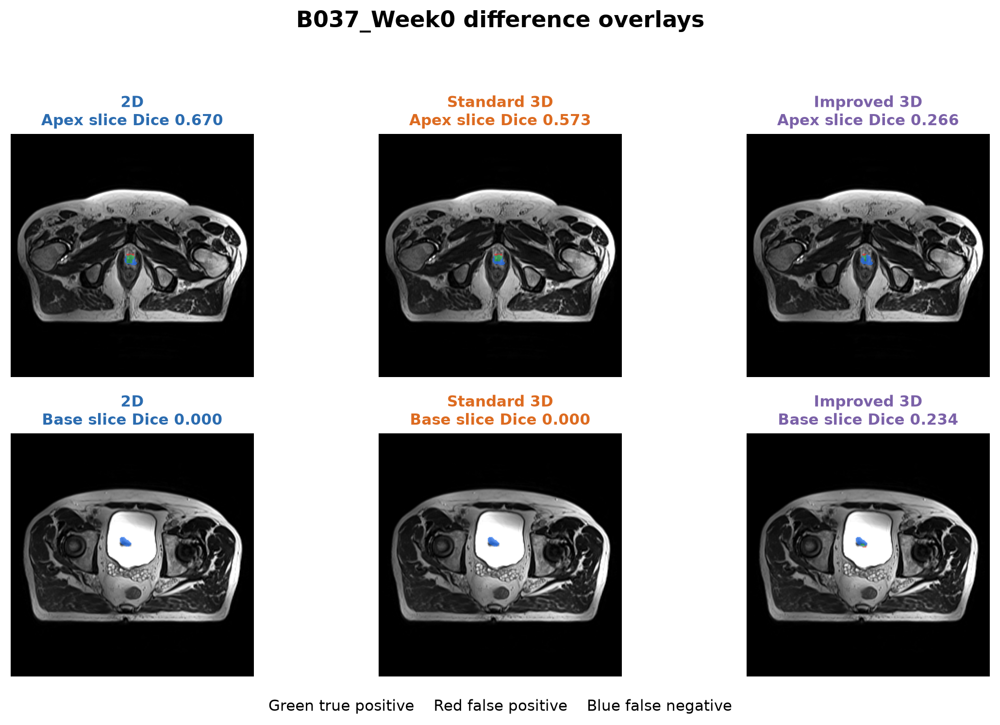

B037 Week0 shows the clearest overall 3D gain. Prostate Dice increased from
0.583 for 2D to 0.781 for Standard 3D and 0.791 for Improved 3D. The 2D
prediction omitted the base band, while the improved model recovered more of
the superior boundary. Even here, the last individual base slice remains
incomplete, so this case still requires boundary review.

### M020 Week0

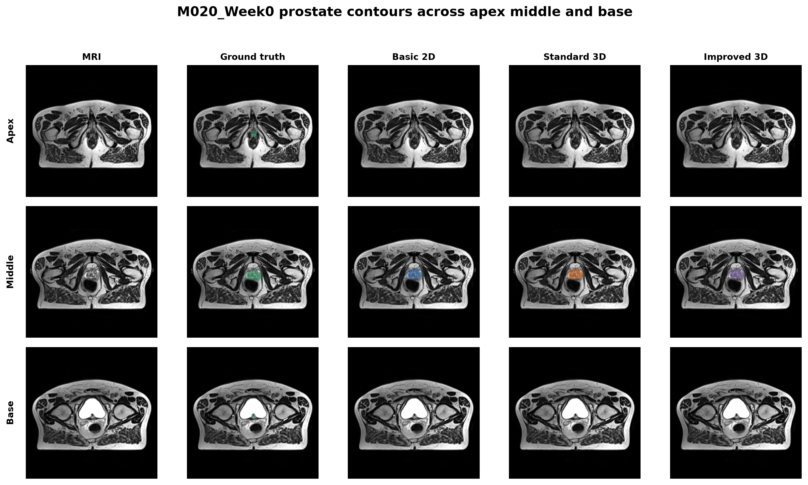

M020 Week0 prevents an overly broad claim that 3D always wins. Whole-volume
prostate Dice was 0.847 for 2D, 0.833 for Standard 3D, and 0.806 for Improved
3D. The organ is clear through much of this scan and a single slice supplies
enough local contrast. The 3D advantage appears mainly in difficult boundary
cases, not uniformly in every patient.

#### M020 Week0 Difference Overlays

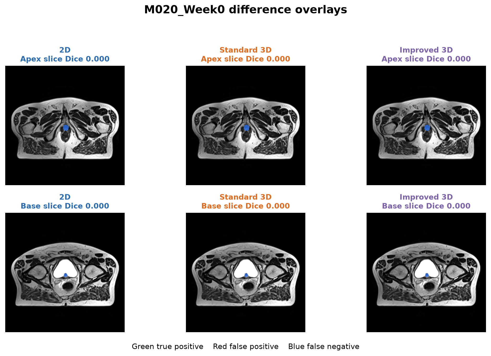

Despite the high reported whole-volume scores, all three restored source-grid
predictions missed the small prostate region on the exact first and last
reference-positive slices, giving an apex-slice and base-slice Dice of 0.000.
The blue false-negative regions in the difference overlays show why
whole-volume Dice alone is insufficient for boundary safety assessment.

## Discussion and Engineering Recommendation

### Five-Case Summary

| Case | 2D prostate | Standard 3D | Improved 3D | Interpretation |
|---|---:|---:|---:|---|
| W029 Week5 | 0.532 | 0.632 | 0.598 | All models weak; 2D misses base band |
| B037 Week0 | 0.583 | 0.781 | 0.791 | Strong 3D recovery |
| M015 Week0 | 0.647 | 0.705 | 0.791 | Improved model helps this patient |
| W029 Week6 | 0.549 | 0.642 | 0.643 | Persistent difficult weekly scan |
| M020 Week0 | 0.847 | 0.833 | 0.806 | Counterexample where 2D is strongest |

### What the Evidence Supports

Both 3D models improved patient-balanced prostate Dice by about 0.068 and
reduced the most severe base errors. This result is anatomically plausible: the
base and apex occupy few slices, so neighbouring levels help distinguish real
continuation from local intensity ambiguity. Published multicentre evidence
similarly reports lower performance at the apex and base than at the midgland
[7].

The evidence does not support a reliable benefit from the additional
improved-model components. Residual blocks and deep supervision made
optimisation feasible and slightly improved pooled prostate Dice, but scan and
patient means were effectively tied with the standard model. A systematic
review of 48 prostate MRI studies also found no statistically significant mean
Dice difference among common U-Net, ResNet, and DenseNet families [6].

### Engineering Recommendation

Use Standard 3D U-Net for the current specialist-reviewed contour-drafting
prototype. It gives the highest patient-balanced prostate Dice, uses fewer
parameters than Improved 3D U-Net, and has lower measured latency. Do not use
any model for autonomous contour approval. Route cases with low whole-prostate,
base, or apex confidence to manual review, and always inspect the base and apex
overlays.

### Limitations and Next Experiments

- Only six patients appear in the test set, so bootstrap intervals are coarse
  and one split cannot prove general superiority.
- Repeated scans are balanced in patient means but remain correlated
  observations.
- Fixed-shape resizing does not preserve physical voxel spacing and may remove
  thin through-plane detail.
- The experiment uses one seed. Multiple patient-level splits or
  cross-validation would test stability.
- A prostate-focused region-of-interest stage or spacing-aware resampling is a
  more targeted next experiment than further increasing architecture
  complexity.

## Reproducibility

### Verified Environment

The reported experiments were run with Python 3.11.17, PyTorch
2.13.0+cu132, Nibabel 5.4.2, NumPy 2.4.6, and Matplotlib 3.11.2 on an
NVIDIA GeForce RTX 5070 with 12 GB VRAM. The random seed was 3710. A matching
Windows PowerShell environment can be created with:

```powershell
python -m venv .venv
.\.venv\Scripts\Activate.ps1
python -m pip install --upgrade pip
python -m pip install torch==2.13.0+cu132 --index-url https://download.pytorch.org/whl/cu132
python -m pip install nibabel==5.4.2 numpy==2.4.6 matplotlib==3.11.2
python -c "import torch; print(torch.__version__); print(torch.cuda.is_available()); print(torch.cuda.get_device_name(0))"
```

Use the PyTorch wheel appropriate for the local CUDA driver if the verified
CUDA 13.2 build is unavailable. This can change low-level numerical behaviour,
so the exact package and GPU versions should be recorded with reproduced
results.

### Dataset Layout and Audit

The data root is not committed to Git. It must contain the paired NIfTI files
under the following directory names; subdirectories are searched recursively.

```text
HipMRI_Study_open/
|-- semantic_MRs/
|   `-- **/*_LFOV.nii.gz
`-- semantic_labels_only/
    `-- **/*_SEMANTIC.nii.gz
```

From this README's directory, audit pairing, affine/shape agreement, the fixed
patient split, and one preprocessed sample before training:

```powershell
$dataRoot = "F:\COMP3710_Data\HipMRI_Study_open"
python .\dataset.py --data-root $dataRoot --inspect-limit 5 --show-split --seed 3710 --smoke-test --target-shape 64 128 128
```

The expected split is 26/6/6 patients and 143/38/30 volumes for
train/validation/test. Repeated scans from one patient remain in one partition.

### Exact Commands for the Reported Training Runs

The program defaults and the following explicit arguments reproduce the
configuration used for the results reported above and recorded in the three
experiment `config.json` files.

```powershell
$dataRoot = "F:\COMP3710_Data\HipMRI_Study_open"
$common = @(
    "--data-root", $dataRoot
    "--epochs", "100"
    "--batch-size", "1"
    "--learning-rate", "0.0003"
    "--weight-decay", "0.00001"
    "--base-channels", "16"
    "--target-shape", "64", "128", "128"
    "--seed", "3710"
    "--patience", "20"
    "--class-weights", "1", "1", "1", "1", "1", "1"
    "--cross-entropy-weight", "0.5"
    "--dice-weight", "0.5"
    "--selection-metric", "mean_foreground_dice"
    "--augmentation", "basic"
    "--device", "cuda"
    "--amp"
)

python .\train.py --model 2d --num-workers 2 --output-dir .\results\2d_baseline @common
python .\train.py --model baseline --num-workers 0 --output-dir .\results\baseline @common
python .\train.py --model improved --num-workers 0 --output-dir .\results\improved @common
```

Run the three commands sequentially rather than concurrently. The class-weight
order is background, bladder, body, bone, rectum, prostate. The worker-count
difference reproduces the recorded runs and affects data loading rather than
the patient split, model, loss, or evaluation definitions.

### Held-Out Inference and Visualisation

Each saved checkpoint contains its model type, input shape, feature width, and
seed, so `predict.py` reconstructs the corresponding network automatically.

```powershell
python .\predict.py --checkpoint .\results\2d_baseline\best_model.pt --data-root $dataRoot --output-dir .\results\analysis_2d_baseline --split test --device cuda --num-visualisations 6 --save-nifti
python .\predict.py --checkpoint .\results\baseline\best_model.pt --data-root $dataRoot --output-dir .\results\analysis_baseline --split test --device cuda --num-visualisations 6 --save-nifti
python .\predict.py --checkpoint .\results\improved\best_model.pt --data-root $dataRoot --output-dir .\results\analysis_improved --split test --device cuda --num-visualisations 6 --save-nifti
```

Training writes `config.json`, `history.json`, `training_curves.png`,
`best_model.pt`, and `results.json` to each model directory. Inference writes
`case_metrics.csv`, `inference_summary.json`, restored NIfTI predictions under
`predictions/`, and worst-case figures under `qualitative/`. The repository
`.gitignore` excludes the dataset, `results/`, and trained weights.

## Artificial Intelligence Usage Disclosure

Codex assisted with refactoring, debugging, documentation drafting, and figure layout. Suggested code was not accepted solely from generated text. It was audited through syntax compilation, tensor-shape smoke tests for all three models, real NIfTI loading, full GPU training, held-out inference, direct inspection of case metrics, and visual comparison of saved predictions with ground truth. The student remains responsible for the reported values, interpretation, and final submission.

## References

1. Ronneberger O, Fischer P, Brox T. [U-Net](https://arxiv.org/abs/1505.04597). MICCAI 2015.
2. Cicek O et al. [3D U-Net](https://arxiv.org/abs/1606.06650). MICCAI 2016.
3. Isensee F et al. [No New-Net](https://arxiv.org/abs/1809.10483). BrainLes 2018.
4. Ulyanov D et al. [Instance Normalization](https://arxiv.org/abs/1607.08022). 2016.
5. Isensee F et al. [nnU-Net](https://www.nature.com/articles/s41592-020-01008-z). Nature Methods 2021.
6. Fassia M et al. [Deep Learning Prostate MRI Segmentation Accuracy and Robustness](https://pmc.ncbi.nlm.nih.gov/articles/PMC11294957/). Radiology AI 2024.
7. Wang W et al. [Multicentre whole-prostate segmentation validation](https://pmc.ncbi.nlm.nih.gov/articles/PMC10167431/). QIMS 2023.
